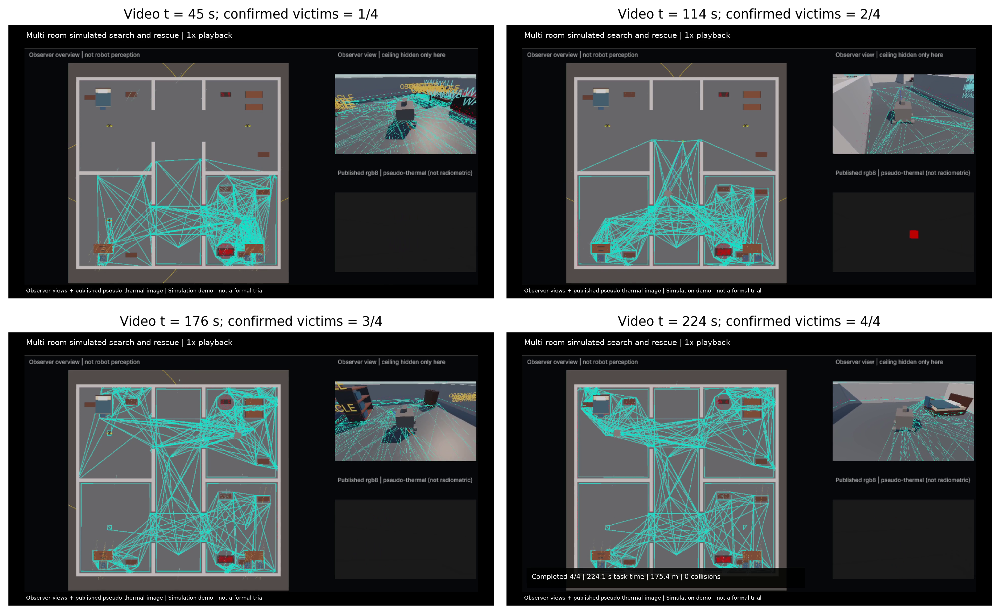

# Unity ROS Fire Rescue

[English](README.md) | [简体中文](README.zh-CN.md)

A configurable Unity–ROS software-in-the-loop prototype for indoor robot search and rescue. The autonomous workflow connects exploration, simulated victim cues, FAR-based navigation, motion execution and rescue confirmation. The current implementation also includes keyboard driving and manual trajectory recording.

This is a **public research release candidate**, not a verified standalone distribution. It is hosted at [OverDominator/cloud](https://github.com/OverDominator/cloud). External ROS dependency delivery, portability and excluded-dependency redistribution checks remain open; see [release checklist](docs/release_checklist.md). The local dependency snapshot and full verification evidence directories are not included in this repository.

## Demonstration video

### Furnished multi-room task

[New real-time video](media/multiroom_rescue_demo_realtime.mp4) · [1.5x presentation video](media/multiroom_rescue_demo_presentation.mp4)

The furnished house demonstration confirms all four simulated victims in 224.096 s over 175.400 m with zero logged collisions. It is not a formal trial. Observer views are not perception inputs; the sensor panel is class-coded pseudo-thermal imagery, not radiometric thermal sensing.

The dissertation's primary evaluation is the frozen furnished-house experiment: 50 paired conditions and 100 valid terminal trials, with four victims and a 600 s limit per trial. The full system succeeds in 49/50 trials (98%) and the no-call variant in 44/50 (88%). All seven valid original timeouts are retained. The exact paired completion test gives p=0.125; the completion-rate difference is not statistically conclusive at the 5% level.

Among the 43 pairs in which both variants succeed, mean times are 221.25/248.86 s and mean distances 168.16/184.44 m (full/no call). These are conditional costs, not all-trial efficiency estimates. See [protocol, exclusions, results and reproducibility limits](docs/multiroom_results_20261007.md).

Start with `formal_batches/20261007_135525/` for frozen audit materials and `results/multiroom_20261007/` for the analysed outcomes. **The repository's top-level `unity/`, `ros/` and legacy launcher are not a verified standalone reproduction of this frozen experiment.** The frozen subset also requires external dependencies and model files; fresh-machine end-to-end reproduction remains unverified. The earlier release and results below are retained as historical evidence, not as additional trials in the dissertation's primary evaluation.



## Supplementary layout evaluation

The scheduled layout evaluation contains **40 original trials**, with ten full/no-call pairs in each of two variants of the same furnished house. Both methods complete 10/10 trials in connected rooms and 9/10 with offset doorways. Each method therefore succeeds in 19/20 trials; no collisions are logged. Both original timeouts remain in the denominator. Diagnostic repeats are excluded and do not replace these outcomes.

Among jointly successful pairs, mean time and distance are 209.44 s / 162.84 m for full versus 232.99 s / 185.54 m for no call in connected rooms (10 pairs), and 256.35 s / 169.50 m versus 283.47 s / 201.81 m with offset doorways (9 pairs). These conditional, descriptive comparisons do not establish a completion-rate advantage or generalisation to independent buildings. Results are reported separately from the 100 primary trials.

See [audited records and scope](results/layout_variants_20261009/summary_EN.txt) and [paired cost figure](results/layout_variants_20261009/layout_paired_costs.png). New scene integration corrected pseudo-thermal renderer enablement by scene name; detection thresholds, mission policies and rescue conditions were not optimised for this evaluation. Three earlier configuration pretests are outside the scheduled sample.

## Historical release and demonstrations

The following sections document the earlier release, its validation and its launch interface. They do not describe the frozen multi-room experiment above. Original/Easy and local-obstacle results remain archived and are not pooled with the 100-trial paired evaluation.

### Earlier Easy scene demonstration

[Download the full Easy scene demonstration](media/fire-rescue-demo-v0.1.0.mp4). The repository is public; if GitHub cannot preview this file, use its download option.

The video shows the Unity observer overview, the robot RGB image and the ROS/RViz planning view from the same run. It preserves the full recording at original speed, with explanatory labels and an end-of-video result caption; no narration or audio track is included. The observer view is not robot perception, and the RGB image is not physical thermal imaging.

All four simulated victims were rescued. The task logger recorded 284.684 seconds and 179.979 metres of travel, with zero logged collisions. This is a separate demonstration, not an additional trial in the main 200 results. See [demonstration evidence](docs/recorded_demo.txt) and [trial summary](results/demo_20261005/trials.csv). It demonstrates one successful run, not guaranteed success or fresh-machine reproducibility.

### Earlier release validation status

On 5 October 2026, an isolated verification copy of the Easy scene completed one full autonomous run: all four simulated victims were rescued in approximately 205.6 seconds, with approximately 131.6 metres of recorded travel. This run used independently built local ROS dependencies and separate logs. It is a release check, not an additional trial in the main 200 results. See [validation evidence summary](docs/full_validation_complete.txt).

Unity 6000.0.75f1 import, ROS Noetic builds, launch resolution, two-way communication and offline Depth Anything V2 loading have been checked on the existing Windows/WSL machine. Installation on a fresh machine, repeatability across runs, and exact historical dependency identity remain unverified.

The current command adapter excludes active wall-following, reverse-escape and trace-back recovery routines. Safety checks and bounded negative commands from the planner remain. Supplementary test scenes and their executable helpers have been removed from this candidate; supplementary result CSVs remain historical data only.

### Earlier release launcher for a prepared environment

After building the release package and the modified external dependencies, specify their workspace setup files and check package discovery:

```bash
FIRE_ROS_SETUP=/path/to/ros_workspace/devel/setup.bash \
FIRE_CMU_SETUP=/path/to/cmu_workspace/devel/setup.bash \
FIRE_RUN_DIR=/path/to/new_run_directory \
bash Tools/ROS/start_release_nav.sh --check
```

The supplied workspaces must expose FAR, the custom Unity integration and ROS-TCP-Endpoint. This check does not build or download them. The recorded demonstration used this launcher in the prepared Windows/WSL validation environment, with Unity and visualization windows started separately. This does not establish fresh-machine installation or exact historical reproduction. See [entrypoint notes](docs/portable_entrypoint.txt). Older shortcut scripts remain machine-specific.

Depth Anything V2 requires separately prepared model files. Missing weights cause the existing localizer to continue with LiDAR-only localization; confirm the model-ready status when testing the intended depth-enabled pipeline. See [model dependency notes](docs/perception_dependency_check.txt).

## Repository map

- `formal_batches/20261007_135525/`: frozen multi-room source subset, scene, schedule and provenance manifests; audit materials, not a complete installable package.
- `results/multiroom_20261007/`: primary paired outcomes, failure records, analysis and task figures.
- `docs/multiroom_results_20261007.md`: primary protocol, inclusion rules, findings and limits.
- `media/multiroom_rescue_demo_realtime.mp4`: independent recorded multi-room demonstration, excluded from the statistical denominator.

Earlier release components retained for provenance:

- `unity/`: Unity project assets, scene configuration and the locally used ROS-TCP-Connector package.
- `ros/fire_perception/`: perception, mission management, safety and recording code for the FAR workflow.
- `Tools/`: existing inspection and recording helpers. Their machine-specific paths are not yet portable.
- `results/main_200/`: four source batch summaries and selected archived code snapshots.
- `results/supplementary_30/`: selected local-obstacle outcomes, reported separately.
- `third_party/`: preserved connector licence and acknowledgements.

Start with [setup status](docs/setup.md), [operation](docs/operation.md) and [experimental scope](docs/experiments.md).

## Historical results and scope

The archived Original scene completed 61 of 100 valid terminal trials and the Easy scene completed 92 of 100, with a 600 s limit per trial. Archived supplementary batches contain ten completed single-victim trials per configuration: End Wall, Right Angle and Left Angle. These datasets used earlier configurations, are excluded from the current dissertation evaluation and are not pooled with the multi-room results. They are preserved rather than deleted.

These results evaluate autonomous operation under specified simulation assumptions, not manual-driving effectiveness or professional firefighter training. The current development code is not labelled as an exact copy of the 200-trial configuration. Archived snapshots are partial evidence, not a complete executable reproduction bundle.

Robot pose and fire locations use simulation information. Visual target cues are simplified. The project does not establish physical radar, thermal-radiation sensing, independent SLAM accuracy or real-fire deployment performance. FAR Planner and Depth Anything V2 are existing methods, not algorithms introduced by this project.

## Licence status

No project-wide licence has been assigned to this release candidate. Public visibility does not itself grant a blanket reuse licence. The ROS package declares MIT in its metadata; third-party rights remain with their respective owners. See [third-party notices](THIRD_PARTY_NOTICES.md) and the [publication review](docs/publication_review_20261006.md).
